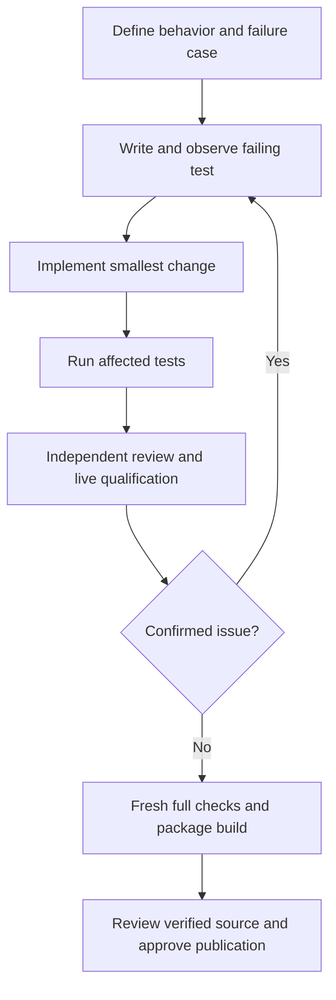

# Development workflow

Keep changes small and preserve the provider-neutral mailbox contract.

1. Describe the behavior and relevant failure case.
2. Add a behavioral test and observe the expected failure.
3. Implement the smallest fix, then run the affected tests.
4. Review routing, duplicate handling, limits, permission boundaries and process cleanup.
5. Add regression tests for confirmed review findings. Fix and retest.
6. Run the full suite, lint, formatting and package build before publishing.



```sh
uv sync --locked --python 3.12 --extra models
uv run --extra models pytest -q
uv run --extra models ruff check .
uv run --extra models ruff format --check .
uv build
```

CI checks both the standard installation and the optional `models` extra. It never
calls an external model or needs provider credentials. CLI adapter tests use small
fake executables; LiteLLM tests exercise an owned local HTTP endpoint with dummy
credentials. Broker and MCP tests use real SQLite and real MCP subprocesses.

Live tests consume provider quota. Use a new ignored state directory for each demo;
preserve failed evidence privately. Never automatically retry an ambiguous turn.
Keep private config, credentials, local paths and raw transcripts out of Git.

To add a runtime, implement `Runtime.start`, `turn`, and `close` from
`src/agent_relay/runtime.py`. Return a stable resumable session ID and explicit errors.
Add it to the CLI adapter registry and test the actual protocol, session resume,
output bounds and owned-process cleanup. The mailbox does not need provider changes.

## Installed-package qualification

Source tests and editable installation do not establish that the wheel works.
Build into a clean candidate directory, install that exact wheel into a fresh
virtual environment, and run `scripts/qualify_install.py` with that interpreter.
Use `--models` only in the separate installation containing the wheel's models
extra. The qualifier checks the console entry point as well as module execution,
version metadata, no-provider MCP operation, external setup, exports, and API use.
See [release preparation](docs/releasing.md). Do not run publication workflows or
push work unless the current task authorizes it.
